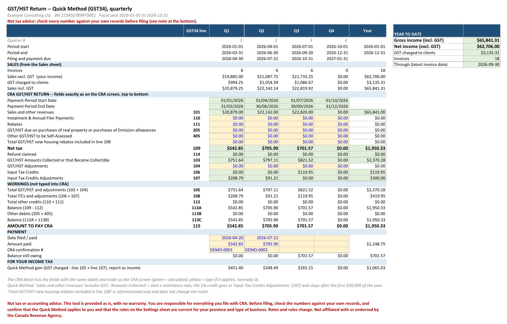
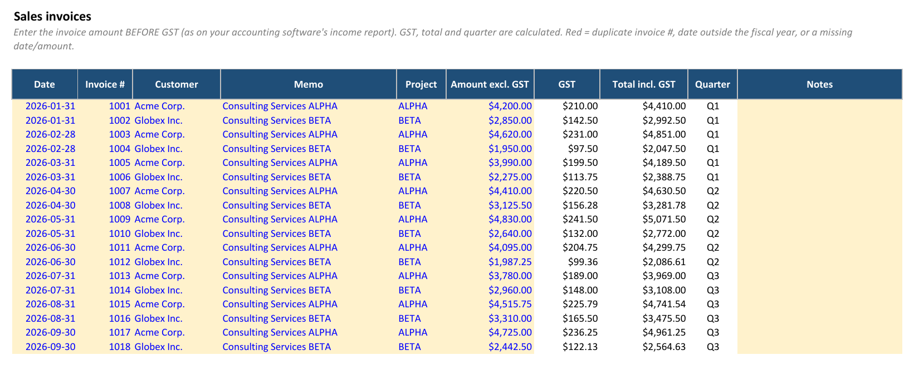
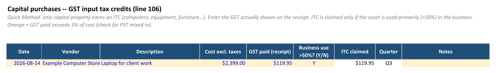

# gst-quick-method

A Claude Code skill and a small CLI for keeping a Canadian **GST/HST Quick Method (GST34)**
workbook for a business that files quarterly.

- One Excel workbook per fiscal year. All the math is Excel formulas; the tool only fills in input cells.
- Paste a screenshot of your income report (e.g. QuickBooks). Claude transcribes the invoices, checks
  them against the image, shows a dry run, then writes them. Re-pasting a year-to-date report is
  safe: invoices already entered are skipped, and any that disagree stop the import.
- Capital purchases (computers, equipment) go in their own sheet and become input tax credits (line 106).
  Paste a receipt or invoice; Claude takes the GST (not PST) and asks whether the item is used more than
  50% for the business.
- The Summary sheet lists the CRA return fields in the order they appear on the CRA screen,
  with the same labels, plus a year-to-date panel and payment tracking.
- `check` recalculates the workbook in real Excel, compares every line with a separate Python
  calculation, and scans for Excel warning flags.

> [!WARNING]
> Not tax or accounting advice. This tool is provided as is, with no warranty. You are responsible for everything you file with CRA. Before filing, check the numbers against your own records, and confirm that the Quick Method applies to you and that the rates on the Settings sheet are current for your province and type of business. Rates and rules change. Not affiliated with or endorsed by the Canada Revenue Agency.

## Screenshots

All data below is fictional. The 1% credit is split across Q1 and Q2 when the year passes
$30,000, and Q3 includes an ITC for a laptop.

**Summary: the return, quarter by quarter**



**Sales: amounts before GST; GST, totals and quarter are calculated**



**Capital purchases: GST from the receipt, claimed if used more than 50% for the business**



## Requirements

- [uv](https://docs.astral.sh/uv/). The script declares its own Python dependencies
  (`openpyxl`, `formulas`) and uv installs them on first run.
- Microsoft Excel, to open and use the workbook.

Works on Windows, macOS, Linux and WSL, from any shell. `check` evaluates every formula with
a pure-Python engine, so it doesn't need Excel. When Excel is reachable (native Windows, or
WSL with Windows Excel) it also recalculates in real Excel and scans for Excel's warning flags.

## Setup

Tell the tool where workbooks live (`{year}` is the fiscal year), in
`~/.config/gst-quick-method/config.json` (on Windows: `%USERPROFILE%\.config\gst-quick-method\config.json`):

```json
{"workbook": "C:\\Accounting\\{year}\\GST Returns {year} - Quick Method.xlsx"}
```

or set the `GST_WORKBOOK` environment variable to the same kind of path. Keep workbooks outside
any git repository.

To make it available to Claude Code, copy or link this folder into `~/.claude/skills/`.

## CLI

Run from this folder (or give the full path to `scripts/gst.py`):

```sh
uv run scripts/gst.py path 2026                  # where the 2026 workbook goes
uv run scripts/gst.py build "<workbook>" --fy-start 2026-01-01 --business "..." --bn "..."
uv run scripts/gst.py add-sales   "<workbook>" rows.json [--dry-run]
uv run scripts/gst.py add-capital "<workbook>" rows.json [--dry-run]
uv run scripts/gst.py record-payment "<workbook>" --quarter 3 --date 2026-10-28 --amount 1234.56 [--confirmation N]
uv run scripts/gst.py check "<workbook>" [--engine auto|python|excel]
uv run scripts/gst.py rebuild "<workbook>"       # move inputs onto the current template
```

JSON row formats are in [SKILL.md](SKILL.md).
